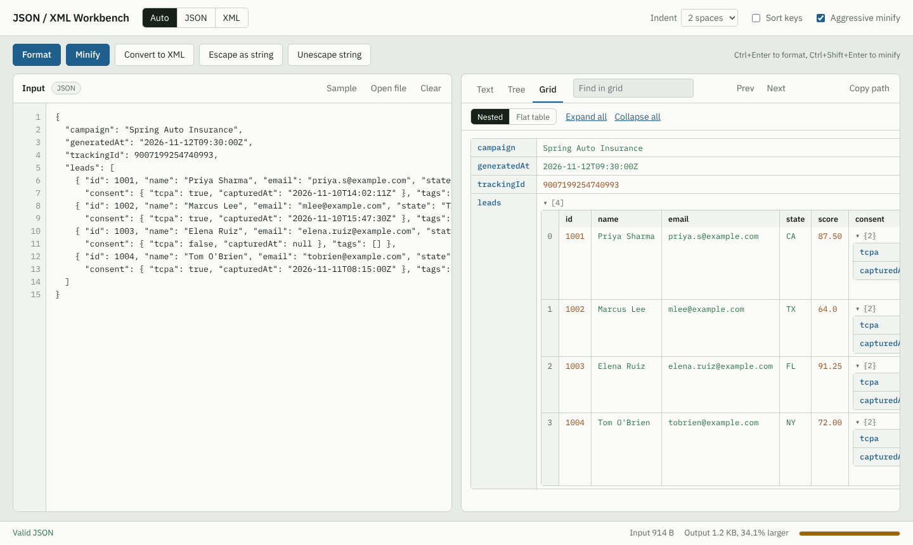

# JSON / XML Workbench

A fast, no-install tool for working with JSON and XML in the browser. Paste a document and you can validate it, format it, minify it, convert between JSON and XML, browse it as a tree or a nested grid, and search through it.

It's plain HTML, CSS and JavaScript. There's no build step, no framework and no server. Everything runs locally in your browser, so nothing you paste is ever uploaded anywhere.

**Live demo:** https://&lt;your-username&gt;.github.io/jsonxml-workbench/



## Features

**Validate**
- Detects JSON or XML automatically, or you can force the type.
- Validates live as you type and shows the line and column of the first error. A "Go to error" link puts the cursor right on it.
- Gives plain-English messages for common mistakes: trailing commas, single quotes, comments, leading zeros, unterminated strings, mismatched XML tags.
- Warns about duplicate keys in JSON.

**Format and minify**
- Pretty-print with 2 spaces, 4 spaces or tabs, with optional key sorting for JSON.
- Minify down to the smallest size that is still valid. Aggressive mode also trims numbers like `87.50` to `87.5`, drops needless escapes, strips XML comments and turns `<a></a>` into `<a/>`.
- Shows the input and output sizes and how much was saved.

**Convert**
- JSON to XML and XML to JSON.
- XML attributes map to `@name` keys, element text maps to `#text`, and repeated elements become arrays.
- Escape a document as a JSON string, or unescape one. This is useful for JSON stored in database columns or log lines.

**Explore**
- **Tree view:** collapsible and lazy-loaded, so large files stay responsive. Click any node to copy its path, like `$.leads[1].email`.
- **Nested grid:** objects show as key/value tables and arrays of objects as proper tables. Nested data sits inside the cell as its own collapsible table, similar to jsongrid.com.
- **Flat table:** pick any array in the document and see it as one table, with nested fields flattened into columns like `consent.tcpa`. Sort by any column, filter rows, copy as TSV for Excel, or download as CSV.
- **Search:** highlights matches in the text output and the grid, and lists matching keys and values with their paths in the tree.

**Handy extras**
- Open a file or drag and drop one onto the editor.
- "Use as input" sends the output back to the editor for chaining steps.
- Your last input and settings are remembered in the browser.
- Light and dark themes follow your system setting.

## Getting started

Clone the repo and open `index.html` in a browser. That's it.

```bash
git clone https://github.com/<your-username>/jsonxml-workbench.git
cd jsonxml-workbench
```

Some browsers restrict a few features on `file://` pages. If anything misbehaves, serve the folder locally instead:

```bash
# Python
python -m http.server 8080

# or Node
npx serve .
```

Then open http://localhost:8080.

### Host it on GitHub Pages

1. Push the repo to GitHub.
2. Go to **Settings > Pages**.
3. Under **Build and deployment**, set the source to **Deploy from a branch**, then pick `main` and `/ (root)`.
4. The site goes live at `https://<your-username>.github.io/jsonxml-workbench/` within a minute or two.

It also works from any static host or an IIS virtual directory. Just copy the files over.

## Keyboard shortcuts

| Shortcut | Action |
| --- | --- |
| `Ctrl + Enter` | Format |
| `Ctrl + Shift + Enter` | Minify |
| `Ctrl + F` (outside the editor) | Jump to the search box |
| `Enter` / `Shift + Enter` in search | Next / previous match |
| `Esc` in search | Clear the search |
| `Tab` in the editor | Insert an indent |

On macOS, use `Cmd` in place of `Ctrl`.

## How it works

**Big numbers are safe.** Most online tools run your JSON through `JSON.parse`, which silently rounds integers above 2^53. An ID like `9007199254740993` comes back as `9007199254740992`. This tool uses its own parser, which keeps every number exactly as written. IDs, account numbers and tracking codes survive formatting and minifying untouched.

**Key order is kept.** JavaScript objects move numeric-looking keys to the front. The parser stores objects as `Map`s, so `{"2": "b", "1": "a"}` stays in that order.

**XML uses the browser's own parser** (`DOMParser`) for validation. Formatting and minifying work on the original text, so attribute order, quoting and CDATA sections are kept as written.

**Large documents:** syntax colouring switches off above about 1.5 MB, so the page stays fast. The tree and grid render in batches with "show more" controls.

## Project structure

```
jsonxml-workbench/
├── index.html          Page layout and controls
├── css/
│   └── styles.css      Theme (light and dark), layout, grid and tree styles
├── js/
│   └── app.js          Parsers, formatter, minifier, converters, tree, grid, search
├── samples/
│   ├── leads.json      Sample JSON (includes a large integer ID)
│   └── leads.xml       Sample XML (attributes, comment, CDATA)
├── docs/
│   └── screenshot.png  Image used in this README
├── .gitignore
├── LICENSE
└── README.md
```

## Browser support

Works in current versions of Chrome, Edge, Firefox and Safari. Internet Explorer is not supported.

## Roadmap

- JSONPath query box
- Diff two documents side by side
- JSON Schema and XSD validation
- CSV to JSON import
- YAML support

## Contributing

Issues and pull requests are welcome. Keep it dependency-free: no frameworks, no bundlers, and everything should still work by opening `index.html` directly.

1. Fork the repo and create a branch: `git checkout -b feature/my-change`
2. Make your change and test it against both samples in `samples/`.
3. Open a pull request describing what changed and why.

## License

[MIT](LICENSE)
